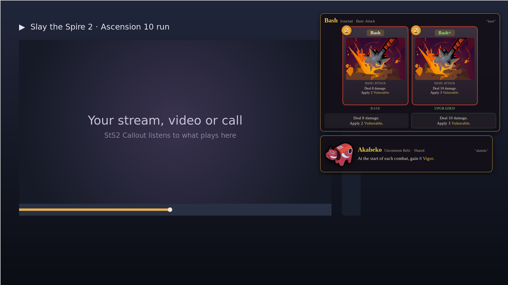
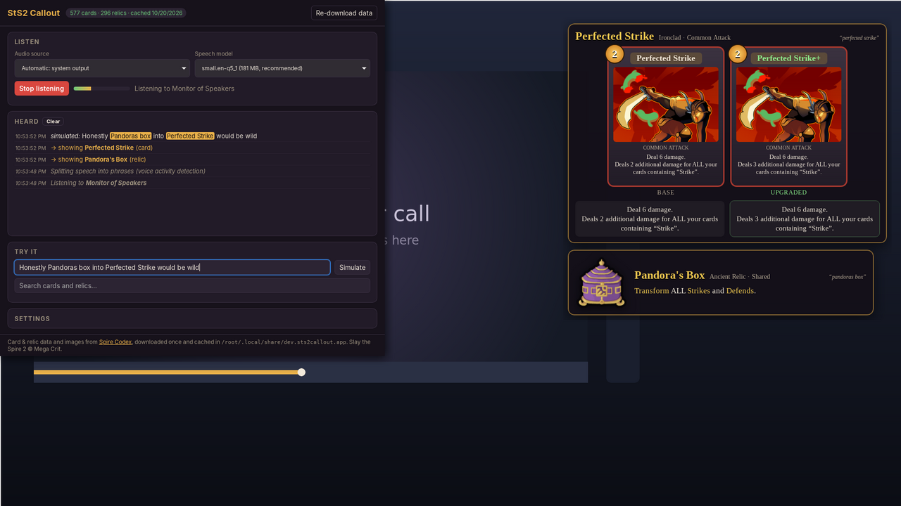
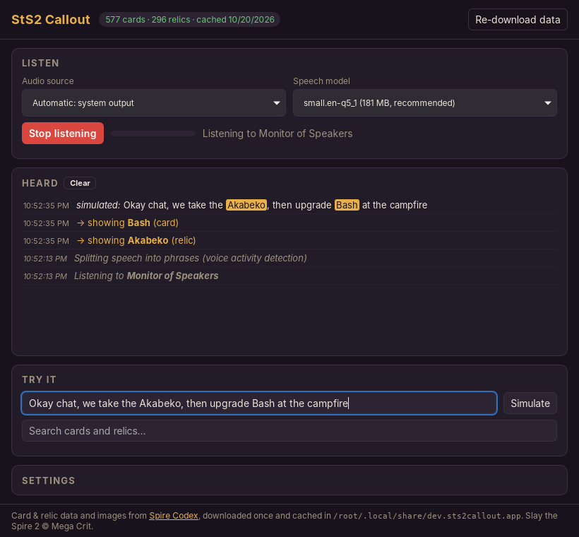
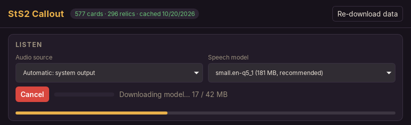
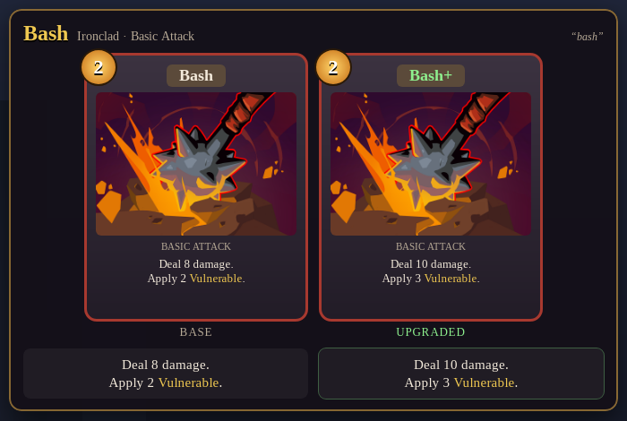
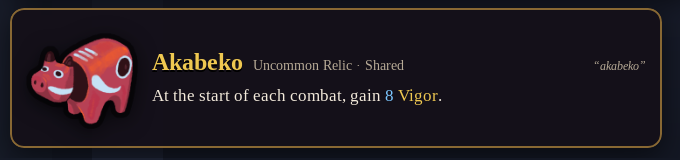
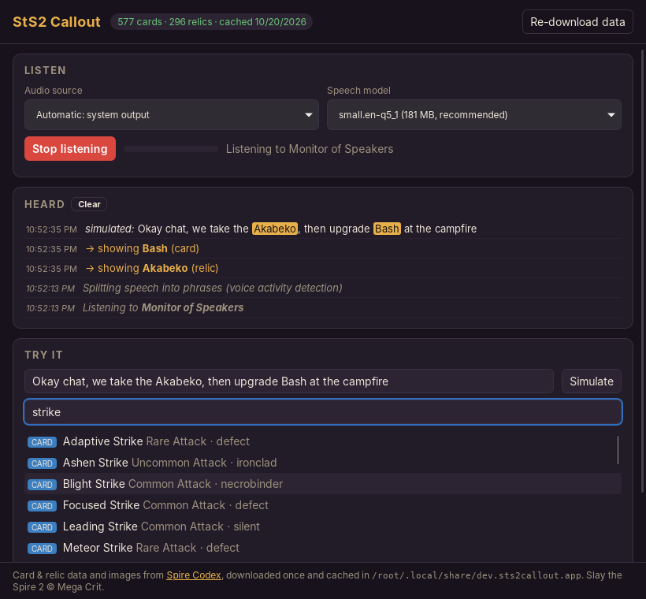
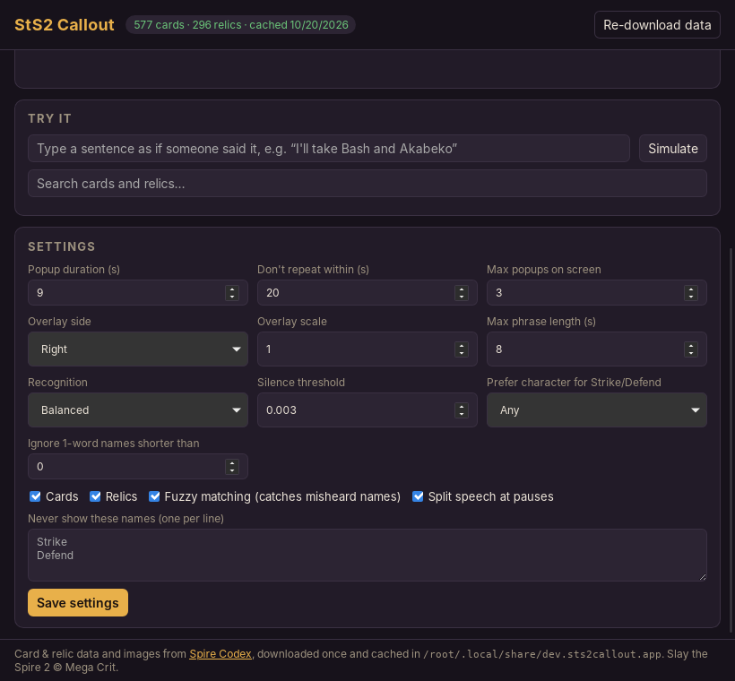
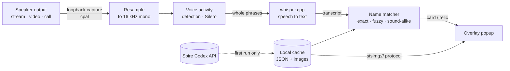

# StS2 Callout

**Hear a Slay the Spire 2 card or relic mentioned, see it on screen.**

StS2 Callout listens to whatever your computer is playing: a Twitch or YouTube stream, a video, or a Discord call. When someone names a card or relic, it pops up in a transparent, click-through overlay:

- **Cards** show base and **upgraded** versions side by side, with both texts.
- **Relics** show their icon, rarity, effect and flavor text.

Speech recognition runs entirely on your machine with [whisper.cpp](https://github.com/ggml-org/whisper.cpp). No audio leaves your computer.



## Features

- **Listens to speaker output.** Nothing to route or configure on Windows, macOS 14.6+ or Linux (PulseAudio/PipeWire).
- **Local, offline speech recognition** with whisper.cpp. Choose a model from `tiny.en` up to `large-v3-turbo`.
- **Phrase detection.** A small voice-activity model splits speech at pauses, so names aren't cut in half.
- **Forgiving name matching.** Exact names, misspellings ("neutralise"), and names that are garbled but sound right ("aka beco" → Akabeko, "happy flour" → Happy Flower) all match. That helps when people talk over each other.
- **Data downloaded once.** All 577 cards and 296 relics, with images, come from [Spire Codex](https://spire-codex.com) one time and are cached locally. The API isn't called again unless you ask.
- **Adjustable.** Popup duration, repeat cooldown, overlay side and size, a block list, which character's Strike/Defend to show, and the speed/accuracy trade-off.

## Getting started

### Windows

1. Download the latest `StS2-Callout-windows.zip` from the [Releases page](../../releases), or [build it yourself](#building-from-source).
2. Unzip it anywhere and run **`StS2 Callout.exe`**. Keep the `.dll` files next to it.
   - The exe isn't code-signed, so SmartScreen may warn you: click **More info → Run anyway**.
   - It needs the Microsoft Edge WebView2 runtime, which comes with Windows 11 and up-to-date Windows 10.
3. Click **Start listening**. The first time, this downloads the speech model (about 180 MB) and a 1 MB voice-activity model.
4. Play a stream or video. Cards and relics appear on the right side of your main screen as they're mentioned.

### macOS and Linux

Build from source (below). On macOS, allow *System Audio Recording* when asked.

## Using it



The **control panel** is a normal window. The **overlay** is a borderless, always-on-top column that ignores the mouse, so you can keep playing or watching underneath it. Closing the control panel quits the app.

### The control panel



- **Audio source:** *Automatic* records your default speakers or headphones. You can also pick a specific output, a virtual cable, or a microphone.
- **Speech model:** `small.en-q5_1` is recommended. See [Models and speed](#models-and-speed).
- **Start listening / Stop listening:** the bar next to the button shows the incoming audio level. While models are downloading the button reads **Cancel**:

  

- **Heard:** every recognized phrase. Matched names are highlighted, and each line shows how long recognition took ("6.0 s audio in 1.1 s"). If the second number is regularly bigger than the first, the app is falling behind, so pick a faster setting.

### Popups

| Card: base and upgraded | Relic |
|---|---|
|  |  |

Each popup shows what was heard (top right) and fades out after the popup duration. Saying the same name again moves it to the top instead of duplicating it. When the column is full, the oldest popup makes room.

> The screenshots were taken on Linux without access to Spire Codex's card images, so the cards use the app's built-in card layout with the card art. Normally the game's own rendered cards from Spire Codex are shown, and the built-in layout is only a fallback.

### Try it without audio



- **Simulate:** type a sentence as if someone said it, e.g. *"we take the Akabeko, then upgrade Bash"*, and press Enter. It goes through the same matcher as real speech.
- **Search:** find any card or relic by name and click it to show it on the overlay.

### Settings



| Setting | What it does |
|---|---|
| Popup duration | How long a popup stays on screen |
| Don't repeat within | Cooldown before the same card or relic pops up again |
| Max popups on screen | Older popups are dismissed first. Popups that don't fit the screen height are dropped too. |
| Overlay side / scale | Which side of the main screen the overlay sits on, and its size |
| Max phrase length | Speech is split at pauses; nonstop talking is cut after this many seconds |
| Recognition | **Fast**, **Balanced** (default) or **Best**. See [Models and speed](#models-and-speed). |
| Silence threshold | Quieter audio is skipped to save CPU |
| Prefer character | Which character's version to show for shared names like Strike and Defend |
| Ignore 1-word names shorter than | Fewer false hits on short everyday words like "Burn", "Rage" or "Feed" |
| Cards / Relics | What to look for |
| Fuzzy matching | Match misheard and sound-alike names (see [How matching works](#how-matching-works)) |
| Split speech at pauses | Use the voice-activity model. If off, fixed overlapping chunks are used. |
| Never show these names | Your own block list, one name per line |

Changing the audio source, model or phrase splitting takes effect the next time you start listening.

## How it works



1. **Capture.** [cpal](https://github.com/RustAudio/cpal) records the system output: WASAPI loopback on Windows, a CoreAudio process tap on macOS, and the PulseAudio/PipeWire monitor source on Linux.
2. **Resample.** Audio is converted to 16 kHz mono with a windowed-sinc filter, so music and high-frequency noise don't alias into the speech band.
3. **Find phrases.** The [Silero](https://github.com/snakers4/silero-vad) voice-activity model, run through whisper.cpp, finds where speech starts and stops. A phrase is sent to the recognizer after a 0.5 s pause, or at a natural gap once it reaches the max phrase length.
4. **Recognize.** [whisper.cpp](https://github.com/ggml-org/whisper.cpp) (via [whisper-rs](https://github.com/tazz4843/whisper-rs)) turns each phrase into text. If it's unsure (low word confidence, typical when people talk over each other) and there's time, it decodes the phrase a second time with beam search and checks both versions for names.
5. **Match.** The transcript is matched against every card and relic name (see below).
6. **Show.** Matches are sent to the overlay window, which loads images from the local cache through a custom `stsimg://` protocol.

### How matching works

Names and transcripts are normalized: lowercased, apostrophes and punctuation removed, `&` → "and", `+` → "plus". Then:

1. **Exact phrases**, longest first, so "Perfected Strike" isn't also reported as "Strike". Plurals work ("two Strikes").
2. **Fuzzy spelling** for names of 7+ letters, using Levenshtein similarity with spaces removed: "neutralise" → Neutralize, "body slam" → Body Slam. A longer fuzzy match can replace a shorter exact one inside it, so "perfect it strike" → Perfected Strike.
3. **Sound-alike** keys (Metaphone-style: vowels dropped, b/p, d/t, g/k, f/v, s/z merged) for garbled names: "aka beco" → Akabeko, "blood vile" → Blood Vial, "happy flour" → Happy Flower.

On a set of ordinary streamer chatter ("path to the elite", "smith at the rest site", "thanks for the follow") the only match is "defend", which is an actual card name. If everyday words like that bother you, add them to **Never show these names**.

### Data and caching

On first launch the app makes two API calls, `GET /api/cards` and `GET /api/relics`, to [Spire Codex](https://spire-codex.com), and stores the responses. In the background it then downloads every card render (base and upgraded), card art and relic icon once. After that everything is served from disk. **Re-download data** fetches it again after a game patch. Speech models are downloaded once from Hugging Face.

| OS      | Cache folder |
|---------|------|
| Windows | `%LOCALAPPDATA%\dev.sts2callout.app\` |
| macOS   | `~/Library/Application Support/dev.sts2callout.app/` |
| Linux   | `~/.local/share/dev.sts2callout.app/` |

## Models and speed

| Model | Download | Notes |
|---|---|---|
| `tiny.en` | 75 MB | Quickest, least accurate |
| `base.en` | 142 MB | Fine for clear, single-speaker audio |
| `small.en-q5_1` | 181 MB | **Recommended.** Much more accurate than base, still CPU-friendly |
| `small.en` | 466 MB | Unquantized small |
| `medium.en-q5_0` | 514 MB | More accurate; needs a fast CPU or a GPU build |
| `large-v3-turbo-q5_0` | 547 MB | Most accurate, best with crosstalk; needs a fast CPU or a GPU build |

**Recognition modes:**
- **Fast** sizes whisper's audio encoder tightly to each phrase.
- **Balanced** leaves extra room.
- **Best** uses the full 30 s encoder plus beam search.

Rough cost of the encoder step for 6 s of audio, from a 4-thread Windows build. Turning the encoded audio into words adds some time on top, and more cores make it faster:

| Model | Fast | Balanced | Best |
|---|---|---|---|
| `base.en` | ~0.35 s | — | ~1.5 s |
| `small.en` | ~1.1 s | ~3.5–4 s | ~4.5–6.5 s |
| `medium.en` | ~3–4 s | — | ~12 s |

The **Heard** log shows the real total for every phrase. If it's regularly longer than the audio, use a faster mode or a smaller model.

## Building from source

Requirements:

- [Rust](https://rustup.rs) (stable) and [Node.js](https://nodejs.org) 20+
- **CMake** and **Clang/LLVM** to build whisper.cpp:
  - Windows: `winget install Kitware.CMake LLVM.LLVM`
  - macOS: `brew install cmake` (clang comes with the Xcode command line tools)
- Tauri's [system dependencies](https://tauri.app/start/prerequisites/). On Debian/Ubuntu: `libwebkit2gtk-4.1-dev libssl-dev librsvg2-dev libasound2-dev build-essential`

```sh
npm install
npm run tauri dev       # run in development mode
npm run tauri build     # installer in src-tauri/target/release/bundle/
```

**GPU acceleration** (makes the larger models practical):

```sh
npm run tauri build -- --features vulkan   # AMD / Intel / NVIDIA (needs the Vulkan SDK)
npm run tauri build -- --features cuda     # NVIDIA (needs the CUDA toolkit)
npm run tauri build -- --features metal    # Apple Silicon
```

`npm run tauri build` tunes whisper.cpp for *your* CPU. To build a binary you'll share, set `GGML_NATIVE=OFF GGML_AVX=ON GGML_AVX2=ON GGML_FMA=ON GGML_F16C=ON` first, as the release workflow does.

**Releases:** pushing a tag like `v0.2.0` runs `.github/workflows/release.yml`, which builds Windows, macOS and Linux installers into a draft GitHub release.

**Cross-compiling for Windows from Linux:**

1. Install `mingw-w64` and run `rustup target add x86_64-pc-windows-gnu`.
2. Run `scripts/build-windows.sh`. The `.exe` and its DLLs end up in `dist-windows/`.

The script enables AVX2/FMA for whisper.cpp, which otherwise turns them off when cross-compiling and runs about 20× slower.

## Troubleshooting

| Problem | Fix |
|---|---|
| The level bar doesn't move | Pick your actual output device under **Audio source**. On Windows the bar is still while nothing is playing. |
| Speech is recognized but names are missed | Use `small.en-q5_1` or larger with **Balanced** or **Best** recognition. Check the **Heard** log to see what was actually heard. |
| Popups arrive late or the log shows it falling behind | Switch Recognition to **Fast**, lower **Max phrase length**, use a smaller model, or build with a GPU feature. |
| Too many popups for everyday words | Add them to **Never show these names**, or raise **Ignore 1-word names shorter than**. |
| "The audio device was disconnected or changed" | Your output device changed (e.g. headphones plugged in). Click **Start listening** again. |
| Black or opaque overlay on Linux | Transparency needs a compositing window manager. GNOME and KDE have one by default. |
| Data or images won't download | The app needs to reach `spire-codex.com` and `cdn.spire-codex.com`. Click **Re-download data** to retry. |

## Development

```sh
npm install && npm run build                      # the Rust build embeds the built frontend
cd src-tauri
cargo test                                        # unit tests: matcher, segmenter, resampler, settings
RUST_LOG=sts2_callout_lib=debug npm run tauri dev # log every phrase and its confidence

# Optional test inputs
STS2_DATA=dir/with/cards.json+relics.json cargo test real_data -- --nocapture
STS2_VAD=ggml-silero-v6.2.0.bin STS2_AUDIO=speech-16k.f32 cargo test vad_stream -- --nocapture

# Point the app at a mirror or mock server
STS2_API_BASE=http://127.0.0.1:8765 STS2_MODEL_BASE=http://127.0.0.1:8765/models npm run tauri dev

# Benchmark whisper on your machine
cargo run --release --example bench_whisper -- path/to/ggml-small.en-q5_1.bin 6
```

| Path | What's there |
|---|---|
| `src-tauri/src/audio.rs` | Loopback / monitor capture with cpal |
| `src-tauri/src/stt.rs` | Resampler, phrase segmentation, whisper decoding |
| `src-tauri/src/matcher.rs` | Name matching (exact, fuzzy, sound-alike) |
| `src-tauri/src/data.rs` | Spire Codex fetch, disk cache, image and model downloads |
| `src-tauri/src/lib.rs` | Tauri commands, listening state, `stsimg://` protocol, overlay placement |
| `src-tauri/src/settings.rs` | Saved settings |
| `index.html`, `src/control.ts` | Control panel |
| `overlay.html`, `src/overlay.ts` | Overlay popups |
| `scripts/build-windows.sh` | Windows cross-build |

## Credits

- Card and relic data and images: [Spire Codex](https://spire-codex.com) ([API terms](https://github.com/ptrlrd/spire-codex/blob/main/API_TERMS.md)). Nothing from it is stored in this repository; it's downloaded at runtime.
- Speech recognition: [whisper.cpp](https://github.com/ggml-org/whisper.cpp) and the [Silero VAD](https://github.com/snakers4/silero-vad) model.
- Built with [Tauri](https://tauri.app), [cpal](https://github.com/RustAudio/cpal) and [whisper-rs](https://github.com/tazz4843/whisper-rs).

The code is MIT-licensed (see [LICENSE](LICENSE)). Slay the Spire 2 and all card and relic content © [Mega Crit](https://www.megacrit.com). StS2 Callout is an unofficial fan project and isn't affiliated with or endorsed by Mega Crit.
